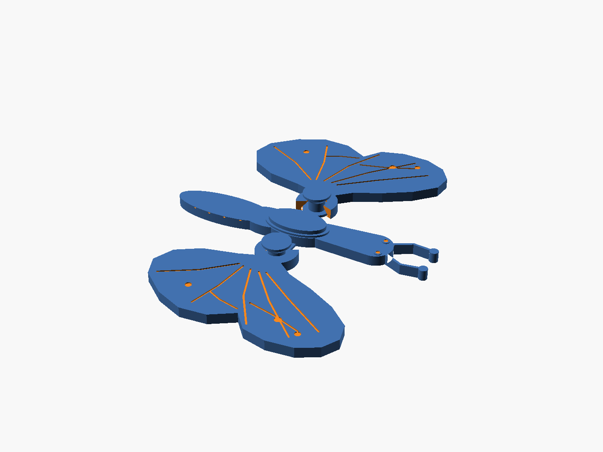
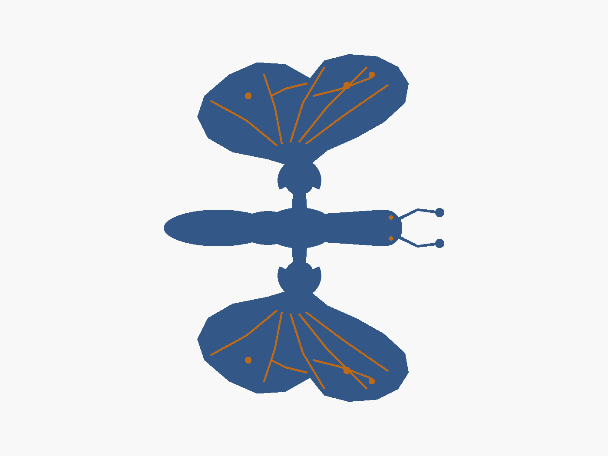
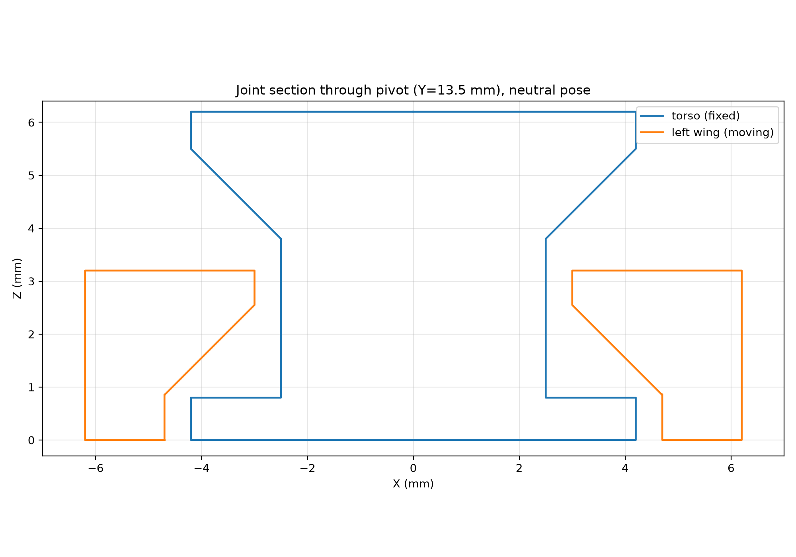

# 双翼可活动蝴蝶（一体化 3D 打印）

## 1. 交付文件

| 文件 | 内容 |
|---|---|
| `model.scad` | 完整参数化 OpenSCAD 源码 |
| `model.stl` | 中立姿态（两翅 0°）完整模型，3 个刚体在同一坐标系中 |
| `parts/parts_1.stl` | 固定躯干（含两侧销轴、下法兰、上蘑菇形防脱帽） |
| `parts/parts_2.stl` | 左翅（+Y 侧） |
| `parts/parts_3.stl` | 右翅（−Y 侧） |
| `joints.json` | 3 个零件、2 个 Z 向旋转关节、轴线位置、±30°范围及验证数据 |
| `preview.png` / `preview_top.png` | 模型等轴测 / 顶视预览 |
| `joint_section.png` | 穿过关节轴线的剖面图（中立姿态） |
| `model_nosupport.gcode` | 实际 0.2 mm、无支撑切片结果（31 层） |
| `checks.txt` | 几何、运动和切片原始检查摘要 |
| `README.md` | 本说明 |

`model.stl` 与 `parts/*.stl` 使用同一坐标系、同一姿态。三个零件 STL 的并集就是 `model.stl`；PrusaSlicer 将 `model.stl` 识别为 `number_of_parts = 3`。

### 预览







## 2. 坐标系与中立姿态

- X：躯干纵向，头朝 +X。
- Y：左右翅膀展开方向，+Y 为左翅。
- Z：竖直方向，也是打印方向。
- 中立姿态：左、右翅均为 0°。
- 整体外接尺寸：**79.6 × 98.6 × 6.2 mm**（X × Y × Z），满足 ≤ 120 × 100 × 30 mm。
- STL 单位为 mm。

## 3. 结构设计

### 3.1 三个独立刚体

1. **躯干**：头、胸、腹、触角、双眼，以及两侧各一套固定销轴组件。
2. **左翅**：圆形根部轮毂 + 前/后翅叶轮廓 + 翅脉装饰。
3. **右翅**：左翅的精确镜像。

两翅之间没有连杆或同步机构，因此一侧转动时另一侧可以完全静止，实现独立运动。

### 3.2 两个销轴式旋转关节

每个关节的轴线均为 **竖直 Z 向**：

- 左关节轴线：`(0, +13.5, z)`，`z = 0 … 6.2 mm`
- 右关节轴线：`(0, −13.5, z)`，`z = 0 … 6.2 mm`

关节由躯干上的固定销轴和翅膀根部的轴承孔组成。销轴/孔为圆柱配合，旋转时径向间隙恒定。

### 3.3 关键间隙

| 配合 | 设计值 |
|---|---|
| 销轴半径 / 翅孔半径 | 2.50 / 3.00 mm |
| 销轴—孔单侧径向间隙 | **0.50 mm**（要求 0.40–0.60） |
| 下法兰半径 / 翅下沉孔半径 | 4.20 / 4.70 mm |
| 下法兰—沉孔单侧径向间隙 | **0.50 mm** |
| 上帽最低点相对翅顶平面 | **0.60 mm**（最低点在孔上方，不占用翅材料） |
| 翅孔上缘—上帽锥面实际轴向间隙 / 上提行程 | **1.10 mm** |
| 翅下轴承肩—下法兰顶面 | **0.55 mm** 轴向间隙 |
| 翅根 130° 让位槽—躯干床面肩部 | ±30° 全程最小 **0.50 mm** |

翅孔下端采用 **45° 自支撑轴承肩**（从 R4.70 过渡到 R3.00），不需要支撑材料；所有活动间隙内均为空气。

### 3.4 轴向防脱

每个关节同时具有上下两道轴向挡边：

- **下挡边**：躯干销轴底部的固定法兰 R4.20，被翅根下部的轴承肩挡住，限制翅膀向下掉落。
- **上挡边**：销轴顶部的蘑菇形帽 R4.20，帽缘大于翅孔 R3.00，从上方压住翅根，限制翅膀向上拔出。
- 上帽底面为 **45° 自支撑圆锥面**，由中心销轴直接支撑，不跨过活动间隙。
- 翅根在 Z 向被夹在“下法兰 + 上蘑菇帽”之间，打印完成后即为机械俘获状态；不需要后期装销、螺丝或胶水。

有效轴向活动量：向上约 1.1 mm 即被上帽锥面挡住；向下约 0.55 mm 即被下法兰挡住。因此不能沿关节轴线直接脱出。

### 3.5 床面连接肩与翅根让位

躯干销轴通过一个 **0.8 mm 高的床面肩部**与躯干主体连成同一刚体。该肩部直接打印在热床上，不需要支撑。

翅膀根部开有面向躯干的 **130° 让位扇形槽**，使固定肩部在 ±30° 摆动过程中始终保持至少 0.5 mm 的间隙。让位槽贯通翅厚，避免在活动间隙上方形成悬空桥。

## 4. 几何检查结果

使用 `trimesh 5.1.1` + `manifold3d` 对最终 STL 检查：

| 检查项 | 结果 |
|---|---|
| `model.stl` 水密 | 是 |
| 法向一致 | 是 |
| 独立连通体数量 | **3** |
| 体积 | 11280.92 mm³ |
| 三个零件体积之和 | 11280.92 mm³（与整体一致） |
| `parts_1.stl`（躯干） | 水密，2775.85 mm³ |
| `parts_2.stl`（左翅） | 水密，4252.53 mm³ |
| `parts_3.stl`（右翅） | 水密，4252.53 mm³ |
| PrusaSlicer `manifold` | yes |
| PrusaSlicer `number_of_parts` | 3 |

PrusaSlicer `--info model.stl` 的输出：

```
size_x = 79.599998
size_y = 98.599998
size_z = 6.200000
number_of_facets = 15944
manifold = yes
number_of_parts = 3
```

## 5. 运动与干涉检查

使用三个独立 STL，将翅膀绕各自关节轴线旋转，再用 `manifold3d` 做布尔相交检查：

- 左翅角度：−30°, −20°, −10°, 0°, +10°, +20°, +30°
- 右翅角度：−30°, −20°, −10°, 0°, +10°, +20°, +30°
- 左右组合：7 × 7 = **49 种同时姿态**
- 检查对象：左翅—躯干、右翅—躯干、左翅—右翅
- 结果：**所有相交体积均为 0，无干涉**
- 进一步加密扫描：每片翅膀按 **1° 步长**扫过 −30°…+30° 对躯干；左右两翅按 **5° 网格**（13 × 13 = 169 种同时姿态）检查；结果仍为 **0 相交**。

补充检查：

- ±30° 全程，翅—躯干最小平面间隙：**0.4997 mm**（出现在销轴/孔与床面肩部/让位槽处）。
- 左右翅同时处于极限姿态时，两翅最小距离约 **16.85 mm**，不会互相碰撞。
- 由于两翅是独立刚体，不存在联动约束；一侧固定、另一侧旋转的姿态也包含在上述组合检查中。
- 翅—躯干额外扫描到约 ±40° 时仍未出现布尔相交，但最小间隙会明显减小，因此额定工作范围保守声明为 **−30° … +30°**。模型没有硬限位，使用时不要强行超过额定范围。

## 6. 打印方向与切片检查

> 本环境没有实体 FDM 打印机；以下为对最终 STL 的实际几何检查，以及 PrusaSlicer 的实际切片检查结果（非实体打印照片）。

### 打印方向

- **平放打印，Z 向上**；所有三个刚体都从 Z=0 热床开始。
- 不需要任何支撑；关节间隙内没有支撑材料。
- 推荐工艺：PLA，0.4 mm 喷嘴，0.2 mm 层高，2 圈壁，15% 填充。

### 实际切片

使用提供的 PrusaSlicer 配置：

```bash
prusa-slicer --export-gcode \
  --load /opt/slicer/p1s_pla_0.20mm_nosupport.ini \
  --output model_nosupport.gcode model.stl
```

检查结果：

| 项目 | 结果 |
|---|---|
| 切片器 | PrusaSlicer 2.7.2 |
| 层高 | 0.2 mm |
| 层数 | **31**（0.2 … 6.2 mm） |
| 支撑路径 `;TYPE:Support material` 数量 | **0** |
| 打印稳定性警告 | **无** |
| 悬空桥警告 | **无** |
| 模型流形 | yes |
| 独立零件数 | 3 |

G-code 中 `support_material = 0`，且全文没有支撑材料路径。上防脱帽由中心销轴支撑，翅根 45° 轴承肩为自支撑面，床面肩部直接落在热床上；因此无需支撑，活动间隙也不依赖支撑。

### 打印注意

1. 关闭自动支撑；不要只在关节区域加支撑。
2. 建议开启 **0.10–0.15 mm 象脚补偿**（elephant-foot compensation），避免首层外扩把 0.5 mm 间隙压小。
3. 首层要压平但不要过压；打印完成后先轻轻活动两翅，确认没有首层粘连，再取下模型。
4. 不要强行把翅膀扳过 ±30° 额定范围。

## 7. 复现命令

```bash
# 完整模型
openscad -D 'PART="all"' -o model.stl model.scad

# 三个独立零件
openscad -D 'PART="torso"'      -o parts/parts_1.stl model.scad
openscad -D 'PART="left_wing"'  -o parts/parts_2.stl model.scad
openscad -D 'PART="right_wing"' -o parts/parts_3.stl model.scad

# 切片（无支撑）
prusa-slicer --export-gcode \
  --load /opt/slicer/p1s_pla_0.20mm_nosupport.ini \
  --output model_nosupport.gcode model.stl
```
